<p align="center">
  <a href="https://pk-plugin.mcsv.me/">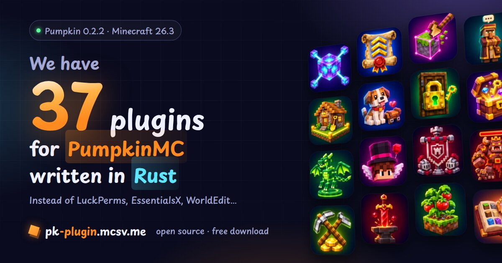</a>
</p>

<h1 align="center">MCSV Pumpkin plugins</h1>

<p align="center">
  Thirty-seven plugins for <a href="https://github.com/Pumpkin-MC/Pumpkin">Pumpkin</a>, the Minecraft Java server written in Rust.
</p>

<p align="center">
  <a href="https://github.com/artmasster/pumpkin-plugins/releases/latest"></a>
  &nbsp;
  <a href="https://pk-plugin.mcsv.me/"></a>
</p>

<p align="center">
  
  
  
  
  <a href="https://mcsv.me"></a>
</p>

<p align="center">
  <b>English</b> · <a href="docs/README.th.md">ไทย</a> · <a href="docs/README.zh-CN.md">简体中文</a> · <a href="docs/README.ja.md">日本語</a>
</p>

---

Paper and Spigot `.jar` plugins do not run on Pumpkin, so each plugin here covers the job of a plugin that server owners already know, with the same commands where that makes sense. All of them are written from scratch in Rust for Pumpkin's plugin API; none contains code from the plugin it stands in for.

They are made by [MCSV](https://mcsv.me), a game server host, and run on its Pumpkin servers. Everything here also works on a Pumpkin server you run yourself.

> **Status:** pre-1.0, like Pumpkin itself. Built and tested against Pumpkin `0.2.2+26.3-26.60` (Minecraft 26.3). Every release passes unit tests, a headless test bot and a console test on the real server binary. Testing with real game clients has been limited so far, so expect rough edges and please report them.

## Plugins

| | Plugin | Stands in for | What it does | Main commands |
|---|---|---|---|---|
|  | `basics` | CMI / EssentialsX | Homes, warps, spawn, tpa, random teleport, ranks, chat, mail, kits, AFK, economy and selling, moderation (mute, tempban, warn, jail, freeze, vanish) | `/home` `/warp` `/spawn` `/tpa` `/rtp` `/kit` `/rank` `/balance` `/pay` · `/basics` lists all |
|  | `perms` | LuckPerms | Groups, inheritance, weight, tracks, prefix and suffix, temporary and per-world permissions, wildcards, with the `/lp` syntax | `/lp user …` `/lp group …` `/lp creategroup` `/lp editor` |
|  | `login` | AuthMe | Register and log in with a password on offline-mode servers; imports AuthMe hashes | `/register` `/login` `/changepassword` · admin `/auth` |
| 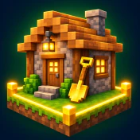 | `claims` | GriefPrevention | Claim land with a golden shovel, three trust levels, claim blocks | `/claim` `/trust` `/untrust` `/claimslist` `/abandonclaim` |
| 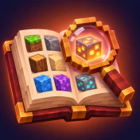 | `blocklog` | CoreProtect | Logs blocks, containers, chat and commands; inspector, lookup, rollback, restore, undo | `/co inspect` `/co lookup` `/co rollback u:name t:1h r:20` |
| 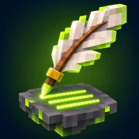 | `scripts` | Skript | A script language with Skript-style syntax: commands, events, variables, loops, functions, chest menus | `/sk reload` `/sk list` `/sk enable` `/sk disable` |
|  | `discordlink` | DiscordSRV | Game chat to a Discord channel and back, through a webhook or a bot token | `/discord` · admin `/discordlink status` |
| 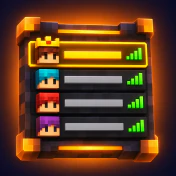 | `tablist` | TAB | Animated header and footer, prefix and order by group in the tab list and above heads, sidebar | `/tablist reload` |
| 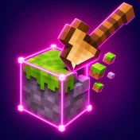 | `worldtools` | WorldEdit | Select with a wooden axe, set, replace, walls, cylinders, spheres, copy, paste, schematics, brushes, undo | `//wand` `//set` `//replace` `//copy` `//paste` `//undo` |
|  | `monitor` | spark | TPS history, time per tick, ping, entity counts, slow tick reports | `/tps` `/spark health` `/spark entities` |
| 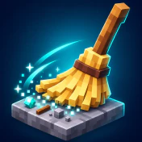 | `cleaner` | ClearLag | Clears dropped items on a schedule with a warning, limits mobs per chunk | `/cleaner now` `/cleaner check` (`/lagg`) |
| 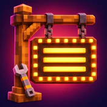 | `motd` | MiniMOTD / Maintenance | Rotating server list messages and a maintenance mode | `/maintenance on [30m]` `/maintenance off` |
|  | `worldmap` | BlueMap / squaremap | A top-down 2D map drawn as players explore, served as a live web map by the plugin itself, or exported as one HTML file | `/worldmap render` `/worldmap web <port>` `/worldmap export` |
|  | `resourcepack` | Resource Pack Downloader / ForcePack | Sends resource packs on join, several packs, per world, optional enforcement, computes the SHA-1 itself | `/rp` `/rp list` `/rp send` |
|  | `skins` | SkinsRestorer | Skins on offline-mode servers, from a Mojang account name or an image link | `/skin <account>` `/skin url <link>` `/skin clear` |
|  | `placeholders` | PlaceholderAPI | `%player_name%` style placeholders for the other plugins, including values they provide | `/papi parse` `/papi list` |
| 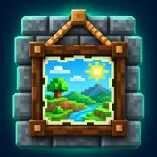 | `imagemap` | ImageOnMap | Turns an image link into a map or a poster of several maps | `/tomap <link> [2x2]` `/imagemap list` |
| 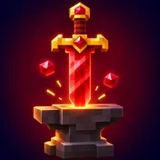 | `customitems` | Oraxen / ItemsAdder / Nexo | Items with their own look from a few lines of config and a picture: builds and sends the resource pack itself, a crafting window, glyphs that can be typed into any text | `/craft` · admin `/customitems` `/customitems give` `/customitems reload` |
|  | `models` | ModelEngine | Animated models made in Blockbench (`.bbmodel`): standing in the world, on a creature or worn by a player, with the resource pack built and sent by the plugin and a message interface for other plugins | `/models place` `/models attach` `/models play` `/models list` |
| 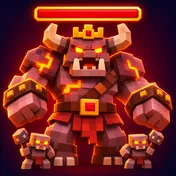 | `mobs` | MythicMobs | Custom mobs from a few lines of config: their own health, damage, speed and size, behaviour, equipment, skills that happen on a timer or when hurt, drops, boss bars and spawners; they wear a model when Models is installed | `/mobs spawn` `/mobs spawner add` `/mobs list` `/mobs near` |
|  | `regions` | WorldGuard | Admin regions (boxes, plus `__global__` per world) with flags: build, interact, pvp, mob damage and spawning, explosions, fire spread, entry, item drop, fall damage, invincible, hunger, greeting and farewell; priority, members and owners | `/rg pos1` `/rg pos2` `/rg define` `/rg flag` `/rg addmember` `/rg list` |
|  | `chatguard` | ChatControl | Thai and English swearing, seen through spaces, dots, repeated letters, digits for letters and Thai tone marks, censored or blocked; IP and domain ads (except `allowed-domains`), fast, repeated and shouted messages, signs, punishment after a number of strikes | `/chatguard test <text>` `/chatguard reload` |
|  | `npcs` | Citizens | NPCs that are creatures of the game (no AI, cannot be hurt, silent) or wear a Models model; they face players, walk a path, and on a right click show a message, run a command, open a dialog, offer a quest or teleport. Dialogs are chat lines with buttons | `/npc create` `/npc select` `/npc action` `/npc dialog` `/npc path` `/npc list` |
|  | `furniture` | ItemsAdder / Nexo furniture | Furniture placed from an item (of CustomItems or of the game), facing the player in 4, 8 or 16 directions; seats, solid pieces, hit to pick it up; respects Claims | `/furniture give` `/furniture list` `/furniture info` `/furniture reload` |
|  | `cosmetics` | HMCCosmetics | A wardrobe of hats, back items and floating things (on a lead or not), made from Models models or item models such as CustomItems items; hats sit in the real helmet slot and give way to armour. Needs Models | `/cosmetics` (`/wardrobe`) `/cosmetics wear` `/cosmetics remove` |
| 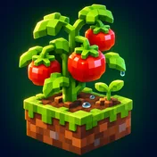 | `crops` | CustomCrops | Custom crops: plant a seed on farmland and it grows through stages over time (only when watered, if you like); bone meal, harvest, replant; uses CustomItems items and Models models when they are installed | `/crops list` `/crops info` `/crops near` `/crops reload` |
|  | `jobs` | Jobs Reborn | Jobs that pay money (through Basics) and xp for breaking, placing, killing, fishing, crafting, smelting, eating and taming, with more pay per level, paid out every few seconds | `/jobs` `/jobs join` `/jobs leave` `/jobs stats` `/jobs top` |
| 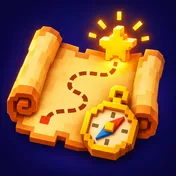 | `quests` | Quests / BetonQuest | Quests with goals (the actions Jobs counts, talking to an NPC, bringing items), rewards in items, money or commands, requirements, cooldowns or repeats; taken from a window or an NPC | `/quests` `/quests accept` `/quests abandon` `/quests list` |
|  | `skills` | mcMMO / AuraSkills | Skills that level up from actions, with double drops into the inventory and extra damage per level, a leaderboard and total power | `/skills` `/skills stats` `/skills top` |
| 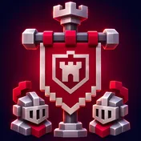 | `clans` | SimpleClans | Clans with tags and ranks (leader, officer, member), invites by a chat button, clan chat, a clan home, no friendly fire, `%clans_tag%` | `/clan create` `/clan invite` `/clan home` `/cc` `/clan list` |
| 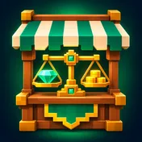 | `market` | AuctionHouse | Players sell the item in hand and buy through a confirm window; sellers are paid minus `sales-tax`, an optional `listing-fee`, expired items go back to a box | `/market` `/market sell <price>` `/market mine` `/market box` (`/ah`) |
|  | `crates` | CrazyCrates | Crate blocks opened with keys: a window that spins and stops on a weighted prize, a left-click preview with the odds, floating labels, a model with an opening animation | `/crates set` `/crates key` `/crates preview` `/crates list` |
|  | `rewards` | DailyRewards / PlaytimeRewards | Daily rewards with a streak (miss a day and it starts over), playtime rewards, a reminder with a claim button on join, days counted in your `utc-offset` | `/daily` `/daily claim` `/daily playtime` |
|  | `pets` | MyPet | Pets that follow you (and warp when far), cannot be hurt, can be ridden with the keys the player presses, take a name and can wear a Models model | `/pets` `/pets call` `/pets dismiss` `/pets name` |
|  | `graves` | GravesX | On death the 36 slots, armour and off hand go into a grave at the spot; the owner gets everything back in the same slots, others may open it after `public-minutes`, it goes after `expire-minutes` | `/graves` `/graves list all` `/graves tp` |
| 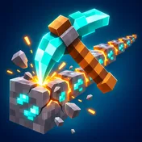 | `veinminer` | VeinMiner / TreeCapitator | Crouch to mine a whole vein or fell a whole tree with the right tool, up to `max-blocks`; drops go into the inventory, the tool wears per block and stops before it breaks; claimed land is skipped | `/veinminer` (on or off for yourself) |
|  | `pregen` | Chunky | Pre-generates the world; pause, continue, and resume after a restart | `/pregen start` `/pregen pause` `/pregen continue` (`/chunky`) |

Names such as LuckPerms, WorldEdit or CoreProtect belong to their own projects. They are named here only to say which job each plugin does. These plugins are not affiliated with or endorsed by those projects.

## Download

**[Download from the latest release](https://github.com/artmasster/pumpkin-plugins/releases/latest)**: one file per plugin, or all of them in one zip with a `pumpkin.toml.example` and `SHA256SUMS`. Release files are built with the Perms web editor off (see below). Each plugin also has its own download button on [pk-plugin.mcsv.me](https://pk-plugin.mcsv.me/).

## Install

Thirty-six plugins are WASM components (`<id>.wasm`) and run in Pumpkin's sandbox. `pregen` is a native library (`libpregen.so`, Linux x86-64) because Pumpkin's WASM API cannot load or generate chunks.

1. Put the file in the server's `plugins/` folder.
2. A WASM plugin needs its sandbox permissions granted in `pumpkin.toml`, or the server asks on the console at every start:

   ```toml
   [plugins.overrides.basics]
   allowed_permissions = ["fs.read.data", "fs.write.data"]
   ```

   Every WASM plugin needs `fs.read.data` and `fs.write.data`. On top of that:

   | Plugins | Extra permissions | Why |
   |---|---|---|
   | `perms`, `discordlink`, `resourcepack`, `skins`, `imagemap` | `http.outbound`, `network.dns` | Web editor, Discord, pack hashes, Mojang skins, image downloads |
   | `worldmap`, `customitems`, `models` | `network.tcp.bind` | The built-in web map, and the resource pack download of CustomItems and Models. Without it the plugin is not loaded at all |

3. Restart the server. The console prints `Loaded <id> (<version>)` for each plugin.

Each plugin keeps its settings and data in `plugins/data/<id>/` and writes a `config.toml` there on first start. Messages are Thai by default; set `language = "en"` in a plugin's `config.toml` for English.

The native `pregen` build links one exact Pumpkin release. Use the build made for the Pumpkin tag you run, or build it yourself after changing the tag in `Cargo.toml`. WASM plugins keep loading on newer Pumpkin releases.

## Things to know

- **Argument tab-completion is off.** On Pumpkin 0.2.2 a WASM plugin's command suggestions crash the server when the console is a terminal, so these plugins register none.
- **Join and quit messages are left alone**, and the server list keeps real player counts. Tools that read `X joined the game` or the ping response keep working.
- **Perms web editor.** `/lp editor` needs an editor service. A plain build has none and says so; the `/lp` commands do everything the editor does. Set `editor-url` in `plugins/data/perms/config.toml` to use a service of your own: the plugin sends `POST <url>/api/perms-editor` with the JSON session and expects `{"code": "…"}`, then `GET <url>/api/perms-editor/<code>` returns what was stored. MCSV runs such a service for the servers it hosts.
- **CustomItems.** Describe items in `plugins/data/customitems/items/*.toml`, put pictures in `textures/` and any other pack files in `pack/`; `/customitems reload` builds `pack.zip`. Players get it when the plugin knows where it is: set `pack.url` to a link you host it at, or `pack.port` and `pack.host` to let the plugin serve it. Recipes are made in the plugin's own window (`/craft`), from items of the game and from other custom items: a crafting table cannot give a custom item on Pumpkin 0.2.2, which keeps only the kind and the number of a recipe's result. The items look as intended in Java clients only; blocks and furniture are not in yet.
- **Models.** Put Blockbench projects (`.bbmodel`, pictures saved inside the file) into `plugins/data/models/models/` and run `/models reload`; the first start writes an example to try with `/models place example`. Every group of cubes becomes one item display; animations named `idle`, `walk`, `hurt` and `death` start by themselves, a group named `h_...` follows where a creature looks, `tag_...` is where a name stands, and a cube named `hitbox` is what can be clicked. A cube turned in a way the game's model files cannot hold becomes a part of its own; meshes are left out. Players get the pack the same way as with CustomItems (`pack.url`, or `pack.port` and `pack.host`), as a second pack. A model on a creature placed by command lasts until the creature unloads; other plugins ask for models with JSON messages (the table is above `fn ipc` in `models/src/plugin.rs`). One moved bone costs the server about 6 microseconds; `update-interval`, `far-distance` and `max-updates-per-tick` in `config.toml` bound it.
- **Mobs.** Describe mobs in `plugins/data/mobs/mobs/*.toml` (the first start writes examples): the creature of the game each one is, its numbers, `ai` to replace its behaviour, `hostile`, `equipment`, `drops`, a `model` of the Models plugin, and `skills` with `on` (`spawn`, `hurt`, `death`, `timer <seconds>`, `health <percent>`) and a list of things to `do` (`message`, `sound`, `particle`, `damage`, `heal`, `effect`, `summon`, `leap`, `ignite`, `teleport`, `animation`, `command`). `/mobs spawn <mob>` makes one, `/mobs spawner add <name> <mob>` keeps a place filled while players are near. A mob lives while a player is within `despawn-range` and is not carried over a restart; spawners are. Pumpkin 0.2.2 does not say who hurt a creature, so drops go to the player closest to the mob when it was last hit, straight into the inventory (`customitems:<id>` gives an item of CustomItems), and the creature's own drops still fall.
- **Gameplay plugins.** Npcs, Furniture, Crates, Pets, Jobs, Quests, Market, Graves, Rewards, Skills, Clans, VeinMiner, Regions, ChatGuard, Cosmetics and Crops write a commented config or an example to `plugins/data/<id>/` on first start; money goes through Basics. Limits of Pumpkin 0.2.2: an NPC dialog is a chat message with buttons, because a dialog screen sent by a plugin never reaches the client; a kill with a bow does not count for Jobs, Quests or Skills, because the event names the arrow, not the shooter; the extra blocks VeinMiner breaks fire no event, so Jobs, Skills and BlockLog do not see them, and Fortune is not counted; a plugin cannot drop an item, so what VeinMiner, Crops and the rewards give goes straight into the inventory. These sixteen have passed the test bot and the console test but have not been played in a real game client yet.
- **Plugins talk to each other** when they are installed together: Basics chat reaches DiscordLink and BlockLog and is checked by ChatGuard first, Placeholders reads balances from Basics, prefixes from Perms and tags from Clans, WorldTools edits are logged by BlockLog, Jobs, Quests and Skills count the same actions, an NPC can offer a quest, Furniture, Crates, Cosmetics, Crops and Pets use items of CustomItems and models of Models, Furniture and VeinMiner respect Claims, and every plugin leaves players alone until Login has let them in.

## Build

```bash
rustup target add wasm32-wasip2
cargo test --workspace --exclude pregen && cargo test -p pregen --no-default-features
cargo build --release --target wasm32-wasip2 -p basics            # target/wasm32-wasip2/release/basics.wasm
RUST_MIN_STACK=33554432 cargo build --release -p pregen           # target/release/libpregen.so
```

The Pumpkin release is pinned in the workspace `Cargo.toml`. For a newer Pumpkin, change the tag on every Pumpkin line there and rebuild.

| Path | What |
|---|---|
| `<id>/` | One crate per plugin (`scripts-plugin/` holds `scripts`) |
| `common/` | Shared code: coloured text, config and state files, HTTP without blocking the tick, messages between plugins |
| `webserver/` | A very small HTTP server that runs from the server tick: the web map of WorldMap and the pack download of CustomItems and Models |
| `packfile/` | A resource pack as a list of files and the zip that holds them, the same bytes for the same content: shared by CustomItems and Models |
| `scripts/example-model.py` | Writes the example model of Models (`models/src/example.bbmodel`), picture included |
| `scripts/particle-table.py` | Writes `common/src/particles.rs` (particle names) from the WIT file of the pinned Pumpkin tag |
| `tools/mcbot/` | A headless Minecraft 26.3 client for tests: joins, runs a script of commands and movements, prints what the server sent |
| `scripts/console-smoke.py` | Types commands into a Pumpkin console that is a real terminal, the way a hosting panel runs it |
| `scripts/publish.sh` | The release gate MCSV runs for its own hosting: tests, release build, load on the real server binary, console test |
| `scripts/og-image.html`, `scripts/og-image.sh` | Source and renderer of the page's share picture (`site/og.jpg`) and PNG icons |
| `site/` | The page at pk-plugin.mcsv.me: plain HTML, CSS and JavaScript, no build step. The plugin art in `site/img/` is MCSV's and is not covered by the MIT license; the font is Playpen Sans Thai under the OFL (`site/fonts/OFL.txt`) |
| `docs/` | This README in Thai, Simplified Chinese and Japanese, and its pictures |

## Made by MCSV

<table>
  <tr>
    <td width="96" align="center"><a href="https://mcsv.me">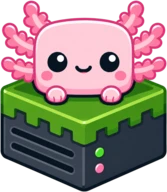</a></td>
    <td>
      These plugins are built and maintained by <a href="https://mcsv.me"><b>MCSV</b></a>, a Minecraft server host based in Thailand.<br>
      On MCSV a Pumpkin server is ready in about 30 seconds, billed by the day, and every plugin here installs from the server's Plugins page.
    </td>
  </tr>
</table>

## License

[MIT](LICENSE). The plugin art in `site/img/` and the MCSV logo in `docs/images/` are MCSV's and are not covered by the MIT license.
