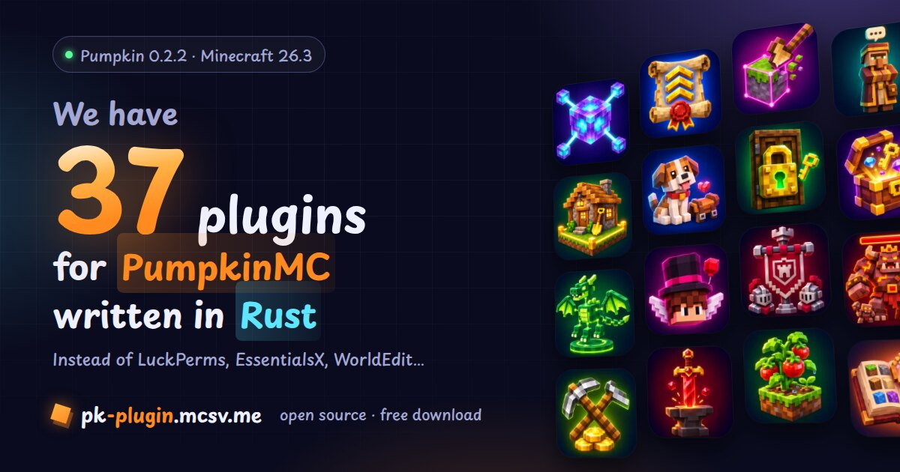

<p align="center">
  <a href="https://pk-plugin.mcsv.me/"></a>
</p>

<h1 align="center">MCSV Pumpkin plugins</h1>

<p align="center">
  Rust で書かれた Minecraft Java サーバー <a href="https://github.com/Pumpkin-MC/Pumpkin">Pumpkin</a> 用の 37 個のプラグインです。
</p>

<p align="center">
  <a href="https://github.com/artmasster/pumpkin-plugins/releases/latest"></a>
  &nbsp;
  <a href="https://pk-plugin.mcsv.me/"></a>
</p>

<p align="center">
  
  
  
  
  <a href="https://mcsv.me"></a>
</p>

<p align="center">
  <a href="../README.md">English</a> · <a href="README.th.md">ไทย</a> · <a href="README.zh-CN.md">简体中文</a> · <b>日本語</b>
</p>

---

Paper や Spigot の `.jar` プラグインは Pumpkin では動きません。そこでここにある各プラグインは、サーバー管理者がすでに知っているプラグインの役割を引き受け、意味がある部分では同じコマンドを使えるようにしています。すべて Pumpkin のプラグイン API 向けに Rust でゼロから書いたもので、置き換え元のプラグインのコードは一切含んでいません。

ゲームサーバーのホスティング事業者 [MCSV](https://mcsv.me) が開発し、MCSV の Pumpkin サーバーで動いています。自分で運営する Pumpkin サーバーでも使えます。

> **状況：** Pumpkin 自体と同じく 1.0 前です。Pumpkin `0.2.2+26.3-26.60`（Minecraft 26.3）でビルドとテストを行っています。各リリースはユニットテスト、画面のないテスト用ボット、実際のサーバー本体でのコンソールテストに合格しています。実際のゲームクライアントでのテストはまだ多くないため、粗い部分があるかもしれません。見つけたら報告してください。

## プラグイン

| | プラグイン | 置き換え元 | できること | 主なコマンド |
|---|---|---|---|---|
|  | `basics` | CMI / EssentialsX | ホーム、ワープ、スポーン、tpa、ランダムテレポート、ランク、チャット、メール、キット、AFK、経済と売却、管理機能（mute、tempban、warn、jail、freeze、vanish） | `/home` `/warp` `/spawn` `/tpa` `/rtp` `/kit` `/rank` `/balance` `/pay` · `/basics` で一覧 |
|  | `perms` | LuckPerms | グループ、継承、weight、track、prefix と suffix、期限付き権限とワールドごとの権限、ワイルドカードを `/lp` の構文で | `/lp user …` `/lp group …` `/lp creategroup` `/lp editor` |
|  | `login` | AuthMe | offline-mode サーバーでパスワードによる登録とログイン。AuthMe のハッシュを取り込めます | `/register` `/login` `/changepassword` · 管理者 `/auth` |
|  | `claims` | GriefPrevention | 金のシャベルで土地を保護、3 段階の trust、保護ブロック | `/claim` `/trust` `/untrust` `/claimslist` `/abandonclaim` |
|  | `blocklog` | CoreProtect | ブロック、コンテナ、チャット、コマンドを記録。inspector、lookup、rollback、restore、undo | `/co inspect` `/co lookup` `/co rollback u:name t:1h r:20` |
|  | `scripts` | Skript | Skript 風の構文のスクリプト言語：コマンド、イベント、変数、ループ、関数、チェストメニュー | `/sk reload` `/sk list` `/sk enable` `/sk disable` |
|  | `discordlink` | DiscordSRV | webhook またはボットのトークンで、ゲーム内チャットと Discord チャンネルをつなぎます | `/discord` · 管理者 `/discordlink status` |
|  | `tablist` | TAB | アニメーションするヘッダーとフッター、グループごとの prefix と並び順（tab リストと頭上）、サイドバー | `/tablist reload` |
|  | `worldtools` | WorldEdit | 木の斧で範囲選択、set、replace、壁、円柱、球、コピー、ペースト、schematic、ブラシ、元に戻す | `//wand` `//set` `//replace` `//copy` `//paste` `//undo` |
|  | `monitor` | spark | TPS の履歴、tick あたりの時間、ping、エンティティ数、遅い tick のレポート | `/tps` `/spark health` `/spark entities` |
|  | `cleaner` | ClearLag | 予告付きで落ちたアイテムを定期的に消去し、チャンクごとの mob 数を制限 | `/cleaner now` `/cleaner check` (`/lagg`) |
|  | `motd` | MiniMOTD / Maintenance | サーバーリストで切り替わるメッセージと、メンテナンスモード | `/maintenance on [30m]` `/maintenance off` |
|  | `worldmap` | BlueMap / squaremap | プレイヤーの探索に合わせて描かれる上から見た 2D マップ。プラグイン自身がライブの Web マップとして公開でき、HTML ファイル 1 つにも書き出せます | `/worldmap render` `/worldmap web <port>` `/worldmap export` |
|  | `resourcepack` | Resource Pack Downloader / ForcePack | 参加時にリソースパックを送信。複数パック、ワールドごと、強制も可能で、SHA-1 は自分で計算します | `/rp` `/rp list` `/rp send` |
|  | `skins` | SkinsRestorer | offline-mode サーバーで、Mojang のアカウント名や画像リンクからスキンを設定 | `/skin <account>` `/skin url <link>` `/skin clear` |
|  | `placeholders` | PlaceholderAPI | ほかのプラグイン向けの `%player_name%` 形式のプレースホルダー。各プラグインが提供する値も含みます | `/papi parse` `/papi list` |
|  | `imagemap` | ImageOnMap | 画像リンクを地図や、複数の地図からなるポスターに変換 | `/tomap <link> [2x2]` `/imagemap list` |
|  | `customitems` | Oraxen / ItemsAdder / Nexo | 数行の設定と画像 1 枚で独自の見た目のアイテム：リソースパックを自分で作って送信し、クラフト画面と、どんな文章にも入力できるグリフを備えています | `/craft` · 管理者 `/customitems` `/customitems give` `/customitems reload` |
|  | `models` | ModelEngine | Blockbench（`.bbmodel`）で作ったアニメーションモデル：ワールドに置く、生き物に付ける、プレイヤーが身に着ける。リソースパックはプラグインが作って送信し、ほかのプラグイン向けのメッセージ窓口もあります | `/models place` `/models attach` `/models play` `/models list` |
|  | `mobs` | MythicMobs | 数行の設定でカスタム mob：体力、攻撃力、速さ、大きさ、行動、装備、時間経過や被ダメージで発動するスキル、ドロップ、ボスバー、スポナー。Models を入れるとモデルを着せられます | `/mobs spawn` `/mobs spawner add` `/mobs list` `/mobs near` |
|  | `regions` | WorldGuard | 管理者用の領域（ボックスと、ワールドごとの `__global__`）とフラグ：建築、操作、PvP、mob のダメージと出現、爆発、延焼、立ち入り、アイテムのドロップ、落下ダメージ、無敵、空腹、入退場メッセージ。優先度、メンバー、オーナー | `/rg pos1` `/rg pos2` `/rg define` `/rg flag` `/rg addmember` `/rg list` |
|  | `chatguard` | ChatControl | タイ語と英語の暴言を、空白、点、文字の繰り返し、数字への置き換え、タイ語の声調記号まで見抜いて伏せ字またはブロック。IP とドメインの宣伝（`allowed-domains` を除く）、連投、繰り返し、叫び、看板にも対応し、一定回数で罰則 | `/chatguard test <文章>` `/chatguard reload` |
|  | `npcs` | Citizens | ゲームの生き物（AI なし、攻撃を受けない、無音）または Models のモデルを着た NPC。プレイヤーの方を向き、経路を歩き、右クリックでメッセージ、コマンド、会話、クエストの提示、テレポートを行います。会話はボタン付きのチャットです | `/npc create` `/npc select` `/npc action` `/npc dialog` `/npc path` `/npc list` |
|  | `furniture` | ItemsAdder / Nexo の家具 | アイテム（CustomItems またはゲームのもの）から置く家具。プレイヤーの向きに合わせて 4、8、16 方向。座れる、当たり判定あり、叩くと回収。Claims の土地を尊重します | `/furniture give` `/furniture list` `/furniture info` `/furniture reload` |
|  | `cosmetics` | HMCCosmetics | 帽子、背中のアイテム、ついてくる浮遊物（リードの有無を選べます）のクローゼット。Models のモデルや、CustomItems のアイテムなどのアイテムモデルから作ります。帽子は本物のヘルメット枠に入り、防具を優先します。Models が必要です | `/cosmetics` (`/wardrobe`) `/cosmetics wear` `/cosmetics remove` |
|  | `crops` | CustomCrops | カスタム作物：耕地に種を植えると時間とともに段階的に育ちます（水を条件にもできます）。骨粉、収穫、植え直しに対応。入っていれば CustomItems のアイテムと Models のモデルを使います | `/crops list` `/crops info` `/crops near` `/crops reload` |
|  | `jobs` | Jobs Reborn | 採掘、設置、討伐、釣り、クラフト、精錬、食事、飼いならしでお金（Basics 経由）と経験値を得る職業。レベルが上がると報酬が増え、数秒ごとにまとめて支払われます | `/jobs` `/jobs join` `/jobs leave` `/jobs stats` `/jobs top` |
|  | `quests` | Quests / BetonQuest | 目標（Jobs と同じ行動、NPC との会話、アイテムの納品）と、アイテム、お金、コマンドの報酬を持つクエスト。前提条件、クールダウン、繰り返しに対応し、画面または NPC から受注します | `/quests` `/quests accept` `/quests abandon` `/quests list` |
|  | `skills` | mcMMO / AuraSkills | 行動でレベルが上がるスキル。インベントリに入るドロップ 2 倍、レベルごとの追加ダメージ、ランキングと総合力 | `/skills` `/skills stats` `/skills top` |
|  | `clans` | SimpleClans | タグと階級（リーダー、副リーダー、メンバー）のあるクラン。チャットのボタンで招待、クランチャット、クランホーム、同士討ち防止、`%clans_tag%` | `/clan create` `/clan invite` `/clan home` `/cc` `/clan list` |
|  | `market` | AuctionHouse | 手に持ったアイテムを出品し、確認画面から購入。売り手には `sales-tax` を引いた額が支払われ、`listing-fee` も設定できます。期限切れの品はボックスに戻ります | `/market` `/market sell <価格>` `/market mine` `/market box` (`/ah`) |
|  | `crates` | CrazyCrates | 鍵で開けるクレートブロック。回転して重みに応じた景品で止まる画面、左クリックで確率付きの景品一覧、浮かぶラベル、開封アニメーション付きのモデル | `/crates set` `/crates key` `/crates preview` `/crates list` |
|  | `rewards` | DailyRewards / PlaytimeRewards | 連続ログインのデイリー報酬（1 日空くと最初から）、プレイ時間の報酬、参加時の受け取りボタン付きのお知らせ。日付は `utc-offset` で数えます | `/daily` `/daily claim` `/daily playtime` |
|  | `pets` | MyPet | ついてくる（離れるとワープする）ペット。攻撃を受けず、プレイヤーのキー操作で乗って動かせ、名前を付けられ、Models のモデルを着せられます | `/pets` `/pets call` `/pets dismiss` `/pets name` |
|  | `graves` | GravesX | 死ぬと 36 スロット、防具、オフハンドがその場の墓に入ります。持ち主は同じスロットにすべて取り戻せ、ほかの人は `public-minutes` 後に開けられ、`expire-minutes` 後に消えます | `/graves` `/graves list all` `/graves tp` |
|  | `veinminer` | VeinMiner / TreeCapitator | しゃがんで正しい道具を使うと、鉱脈や木を `max-blocks` までまとめて掘る、または伐採。ドロップはインベントリへ入り、道具はブロックごとに消耗して壊れる前に止まります。保護された土地は対象外です | `/veinminer`（自分の有効と無効を切り替え） |
|  | `pregen` | Chunky | ワールドを事前生成。一時停止、再開、再起動後の続行が可能 | `/pregen start` `/pregen pause` `/pregen continue` (`/chunky`) |

LuckPerms、WorldEdit、CoreProtect などの名前はそれぞれのプロジェクトのものです。ここでは各プラグインの役割を示すためだけに挙げています。これらのプラグインは、それらのプロジェクトと関係がなく、公認も受けていません。

## ダウンロード

**[最新リリースからダウンロード](https://github.com/artmasster/pumpkin-plugins/releases/latest)**：プラグインごとのファイル、またはすべてをまとめた zip（`pumpkin.toml.example` と `SHA256SUMS` 付き）があります。リリースのファイルは Perms の Web エディターを無効にしてビルドしています（下記参照）。[pk-plugin.mcsv.me](https://pk-plugin.mcsv.me/) にも各プラグインのダウンロードボタンがあります。

## インストール

36 個のプラグインは WASM コンポーネント（`<id>.wasm`）で、Pumpkin のサンドボックスで動きます。`pregen` はネイティブライブラリ（`libpregen.so`、Linux x86-64）です。Pumpkin の WASM API ではチャンクの読み込みや生成ができないためです。

1. ファイルをサーバーの `plugins/` フォルダーに置きます。
2. WASM プラグインには `pumpkin.toml` でサンドボックスの権限を与える必要があります。与えないと、起動のたびにコンソールで確認されます：

   ```toml
   [plugins.overrides.basics]
   allowed_permissions = ["fs.read.data", "fs.write.data"]
   ```

   すべての WASM プラグインに `fs.read.data` と `fs.write.data` が必要です。さらに：

   | プラグイン | 追加の権限 | 理由 |
   |---|---|---|
   | `perms`, `discordlink`, `resourcepack`, `skins`, `imagemap` | `http.outbound`, `network.dns` | Web エディター、Discord、パックのハッシュ、Mojang のスキン、画像のダウンロード |
   | `worldmap`, `customitems`, `models` | `network.tcp.bind` | 内蔵の Web マップと、CustomItems と Models のリソースパック配信。この権限がないとプラグインはまったく読み込まれません |

3. サーバーを再起動します。コンソールに各プラグインの `Loaded <id> (<version>)` が表示されます。

各プラグインは設定とデータを `plugins/data/<id>/` に保存し、初回起動時にそこへ `config.toml` を書き出します。メッセージの既定はタイ語です。英語にするにはプラグインの `config.toml` で `language = "en"` を設定します。

ネイティブの `pregen` は Pumpkin の特定の 1 リリースにリンクしています。使っている Pumpkin の tag 向けのビルドを使うか、`Cargo.toml` の tag を変えて自分でビルドしてください。WASM プラグインは新しい Pumpkin でも読み込めます。

## 知っておくこと

- **引数の Tab 補完は無効です。** Pumpkin 0.2.2 では、コンソールが端末のとき WASM プラグインのコマンド補完がサーバーを落とすため、これらのプラグインは補完を登録していません。
- **参加と退出のメッセージは変更しません。** サーバーリストも実際のプレイヤー数を表示します。`X joined the game` や ping の応答を読むツールはそのまま動きます。
- **Perms の Web エディター。** `/lp editor` にはエディターのサービスが必要です。通常のビルドにはなく、その旨を表示します。エディターでできることはすべて `/lp` コマンドでもできます。自分のサービスを使うには `plugins/data/perms/config.toml` で `editor-url` を設定します。プラグインは JSON のセッションを付けて `POST <url>/api/perms-editor` を送り、`{"code": "…"}` を受け取ります。その後 `GET <url>/api/perms-editor/<code>` が保存された内容を返します。MCSV はホストしているサーバー向けにこのサービスを運営しています。
- **CustomItems。** アイテムは `plugins/data/customitems/items/*.toml` に書き、画像は `textures/` に、その他のパック用ファイルは `pack/` に置きます。`/customitems reload` で `pack.zip` が作られます。プラグインがその場所を知っていれば、プレイヤーはパックを受け取れます。ファイルを置いたリンクを `pack.url` に設定するか、`pack.port` と `pack.host` を設定してプラグイン自身に配信させます。レシピはプラグインの画面（`/craft`）で、ゲームのアイテムやほかのカスタムアイテムから作ります。Pumpkin 0.2.2 の作業台はレシピの結果の種類と数しか保持せず、カスタムアイテムを出せないためです。意図した見た目になるのは Java クライアントだけで、ブロックと家具はまだありません。
- **Models。** Blockbench のプロジェクト（`.bbmodel`、画像はファイル内に保存）を `plugins/data/models/models/` に置き、`/models reload` を実行します。初回起動時にサンプルが書き出されるので、`/models place example` で試せます。キューブのグループはそれぞれ 1 つの item display になります。`idle`、`walk`、`hurt`、`death` という名前のアニメーションは自動で再生され、`h_...` という名前のグループは生き物の視線に合わせて向き、`tag_...` は名前を表示する位置、`hitbox` という名前のキューブはクリックできる部分です。ゲームのモデルファイルで表せない向きに回転したキューブは独立した部品になり、メッシュは使われません。プレイヤーは CustomItems と同じ方法（`pack.url`、または `pack.port` と `pack.host`）で、2 つ目のパックとして受け取ります。コマンドで生き物に付けたモデルは、その生き物がアンロードされるまで残ります。ほかのプラグインは JSON メッセージでモデルを要求できます（表は `models/src/plugin.rs` の `fn ipc` の上にあります）。動くボーン 1 本あたりサーバーの負荷は約 6 マイクロ秒で、`config.toml` の `update-interval`、`far-distance`、`max-updates-per-tick` で上限を決められます。
- **Mobs。** mob は `plugins/data/mobs/mobs/*.toml` に書きます（初回起動時にサンプルが書き出されます）。元になるゲームの生き物、各種の数値、行動を置き換える `ai`、`hostile`、`equipment`、`drops`、Models プラグインの `model`、そして `on`（`spawn`、`hurt`、`death`、`timer <秒>`、`health <パーセント>`）と実行する `do` の一覧（`message`、`sound`、`particle`、`damage`、`heal`、`effect`、`summon`、`leap`、`ignite`、`teleport`、`animation`、`command`）を持つ `skills` です。`/mobs spawn <mob>` で 1 体出し、`/mobs spawner add <名前> <mob>` でプレイヤーが近くにいる間その場所に mob を保ちます。mob は `despawn-range` 内にプレイヤーがいる間だけ存在し、再起動では引き継がれません。スポナーは引き継がれます。Pumpkin 0.2.2 は誰が生き物を攻撃したかを伝えないため、ドロップは最後に攻撃されたときに mob の最も近くにいたプレイヤーのインベントリに直接入ります（`customitems:<id>` で CustomItems のアイテムを渡せます）。生き物本来のドロップはそのまま落ちます。
- **ゲームプレイ系のプラグイン。** Npcs、Furniture、Crates、Pets、Jobs、Quests、Market、Graves、Rewards、Skills、Clans、VeinMiner、Regions、ChatGuard、Cosmetics、Crops は、初回起動時に説明付きの設定またはサンプルを `plugins/data/<id>/` に書き出します。お金は Basics を使います。Pumpkin 0.2.2 の制限：プラグインが送る会話画面はクライアントに届かないため、NPC の会話はボタン付きのチャットです。イベントが射手ではなく矢を示すため、弓での討伐は Jobs、Quests、Skills に数えられません。VeinMiner が追加で壊したブロックはイベントを出さないため、Jobs、Skills、BlockLog には見えず、幸運も数えません。プラグインはアイテムを地面に落とせないため、VeinMiner、Crops、各種報酬の品は直接インベントリに入ります。この 16 個はテスト用ボットとコンソールテストに合格していますが、実際のゲームクライアントではまだ遊ばれていません。
- **一緒に入れるとプラグイン同士が連携します。** Basics のチャットは DiscordLink と BlockLog に届き、先に ChatGuard が確認します。Placeholders は Basics から残高を、Perms から prefix を、Clans からタグを読み、WorldTools の編集は BlockLog に記録されます。Jobs、Quests、Skills は同じ行動を数え、NPC はクエストを提示でき、Furniture、Crates、Cosmetics、Crops、Pets は CustomItems のアイテムと Models のモデルを使い、Furniture と VeinMiner は Claims の土地を尊重します。どのプラグインも、Login が通すまではプレイヤーに手を出しません。

## ビルド

```bash
rustup target add wasm32-wasip2
cargo test --workspace --exclude pregen && cargo test -p pregen --no-default-features
cargo build --release --target wasm32-wasip2 -p basics            # target/wasm32-wasip2/release/basics.wasm
RUST_MIN_STACK=33554432 cargo build --release -p pregen           # target/release/libpregen.so
```

Pumpkin のリリースは workspace の `Cargo.toml` で固定しています。新しい Pumpkin を使うには、そこにある Pumpkin の行の tag をすべて変えてビルドし直します。

| パス | 中身 |
|---|---|
| `<id>/` | プラグインごとに 1 つの crate（`scripts-plugin/` が `scripts`） |
| `common/` | 共通コード：色付きテキスト、設定と状態のファイル、tick を止めない HTTP、プラグイン間のメッセージ |
| `webserver/` | サーバーの tick から動くごく小さな HTTP サーバー：WorldMap の Web マップと、CustomItems と Models のパック配信 |
| `packfile/` | ファイルの一覧と、それを入れた zip としてのリソースパック。同じ内容なら同じバイト列：CustomItems と Models で共用 |
| `scripts/example-model.py` | Models のサンプルモデル（`models/src/example.bbmodel`）を画像込みで書き出します |
| `scripts/particle-table.py` | 固定した Pumpkin tag の WIT ファイルから `common/src/particles.rs`（パーティクル名）を書き出します |
| `tools/mcbot/` | テスト用の画面のない Minecraft 26.3 クライアント：参加して、コマンドと移動のスクリプトを実行し、サーバーから届いたものを表示します |
| `scripts/console-smoke.py` | ホスティングのパネルと同じように、本物の端末になっている Pumpkin のコンソールにコマンドを打ち込みます |
| `scripts/publish.sh` | MCSV が自社ホスティング用に実行するリリースの関門：テスト、リリースビルド、実際のサーバー本体での読み込み、コンソールテスト |
| `scripts/og-image.html`, `scripts/og-image.sh` | ページの共有画像（`site/og.jpg`）と PNG アイコンの元ファイルと描画スクリプト |
| `site/` | pk-plugin.mcsv.me のページ：素の HTML、CSS、JavaScript で、ビルド工程はありません。`site/img/` のプラグインのイラストは MCSV のもので MIT ライセンスの対象外です。フォントは OFL の Playpen Sans Thai（`site/fonts/OFL.txt`） |
| `docs/` | この README のタイ語、簡体字中国語、日本語版と、その画像 |

## MCSV が開発しています

<table>
  <tr>
    <td width="96" align="center"><a href="https://mcsv.me"></a></td>
    <td>
      これらのプラグインは、タイを拠点とする Minecraft サーバーホスティング <a href="https://mcsv.me"><b>MCSV</b></a> が開発・保守しています。<br>
      MCSV なら Pumpkin サーバーは約 30 秒で用意でき、料金は日単位です。ここにあるプラグインはすべてサーバーのプラグイン画面からインストールできます。
    </td>
  </tr>
</table>

## ライセンス

[MIT](../LICENSE)。`site/img/` のプラグインのイラストと `docs/images/` の MCSV ロゴは MCSV のもので、MIT ライセンスの対象外です。
