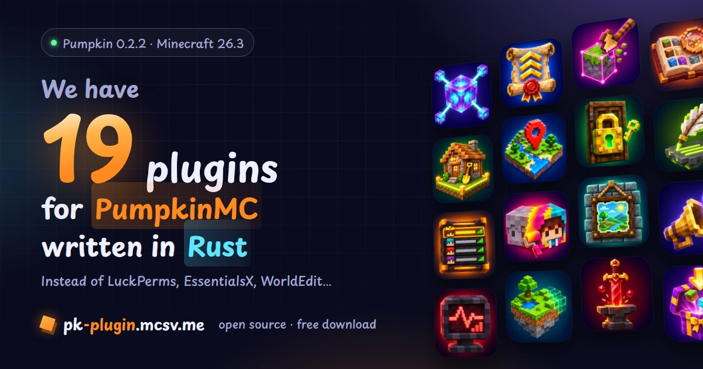

<p align="center">
  <a href="https://pk-plugin.mcsv.me/"></a>
</p>

<h1 align="center">MCSV Pumpkin plugins</h1>

<p align="center">
  ปลั๊กอิน 21 ตัวสำหรับ <a href="https://github.com/Pumpkin-MC/Pumpkin">Pumpkin</a> เซิร์ฟเวอร์ Minecraft Java ที่เขียนด้วย Rust
</p>

<p align="center">
  <a href="https://github.com/artmasster/pumpkin-plugins/releases/latest"></a>
  &nbsp;
  <a href="https://pk-plugin.mcsv.me/"></a>
</p>

<p align="center">
  
  
  
  
  <a href="https://mcsv.me"></a>
</p>

<p align="center">
  <a href="../README.md">English</a> · <b>ไทย</b> · <a href="README.zh-CN.md">简体中文</a> · <a href="README.ja.md">日本語</a>
</p>

---

ปลั๊กอิน `.jar` ของ Paper และ Spigot ใช้กับ Pumpkin ไม่ได้ ปลั๊กอินแต่ละตัวในนี้จึงทำหน้าที่แทนปลั๊กอินที่เจ้าของเซิร์ฟคุ้นเคย และใช้คำสั่งเดียวกันในจุดที่สมเหตุสมผล ทุกตัวเขียนใหม่ทั้งหมดด้วย Rust สำหรับ plugin API ของ Pumpkin ไม่มีโค้ดของปลั๊กอินที่มันใช้แทนอยู่ข้างใน

พัฒนาโดย [MCSV](https://mcsv.me) ผู้ให้บริการเซิร์ฟเวอร์เกม และใช้งานอยู่บนเซิร์ฟ Pumpkin ของ MCSV ทุกตัวใช้กับเซิร์ฟ Pumpkin ที่คุณเปิดเองได้ด้วย

> **สถานะ:** ยังไม่ถึง 1.0 เหมือน Pumpkin เอง build และทดสอบกับ Pumpkin `0.2.2+26.3-26.60` (Minecraft 26.3) ทุกรุ่นผ่าน unit test, บอททดสอบแบบไม่มีจอ และการทดสอบ console บนไบนารีเซิร์ฟเวอร์จริง การทดสอบกับ client เกมจริงยังมีไม่มาก อาจเจอจุดที่ยังไม่เรียบร้อย ถ้าเจอช่วยแจ้งด้วยครับ

## ปลั๊กอิน

| | ปลั๊กอิน | ใช้แทน | ทำอะไร | คำสั่งหลัก |
|---|---|---|---|---|
|  | `basics` | CMI / EssentialsX | บ้าน วาร์ป จุดเกิด tpa สุ่มวาร์ป ยศ แชต จดหมาย kit AFK ระบบเงินและการขายของ และเครื่องมือดูแลเซิร์ฟ (mute, tempban, warn, jail, freeze, vanish) | `/home` `/warp` `/spawn` `/tpa` `/rtp` `/kit` `/rank` `/balance` `/pay` · `/basics` ดูทั้งหมด |
|  | `perms` | LuckPerms | กลุ่ม การสืบทอด weight track prefix และ suffix สิทธิ์ชั่วคราวและสิทธิ์แยกตามโลก wildcard ด้วยไวยากรณ์ `/lp` | `/lp user …` `/lp group …` `/lp creategroup` `/lp editor` |
|  | `login` | AuthMe | สมัครและล็อกอินด้วยรหัสผ่านบนเซิร์ฟ offline mode นำเข้ารหัสผ่านจาก AuthMe ได้ | `/register` `/login` `/changepassword` · แอดมิน `/auth` |
|  | `claims` | GriefPrevention | จองที่ดินด้วยพลั่วทอง trust สามระดับ บล็อกจอง | `/claim` `/trust` `/untrust` `/claimslist` `/abandonclaim` |
|  | `blocklog` | CoreProtect | บันทึกบล็อก กล่อง แชต และคำสั่ง มี inspector, lookup, rollback, restore, undo | `/co inspect` `/co lookup` `/co rollback u:name t:1h r:20` |
|  | `scripts` | Skript | ภาษาสคริปต์ไวยากรณ์แบบ Skript: คำสั่ง event ตัวแปร loop function เมนูกล่อง | `/sk reload` `/sk list` `/sk enable` `/sk disable` |
|  | `discordlink` | DiscordSRV | ส่งแชตในเกมไปห้อง Discord และกลับ ผ่าน webhook หรือ token ของบอท | `/discord` · แอดมิน `/discordlink status` |
|  | `tablist` | TAB | header และ footer แบบเคลื่อนไหว prefix และลำดับตามกลุ่มใน tab และเหนือหัว sidebar | `/tablist reload` |
|  | `worldtools` | WorldEdit | เลือกพื้นที่ด้วยขวานไม้ set, replace, กำแพง ทรงกระบอก ทรงกลม copy, paste, schematic, แปรง, undo | `//wand` `//set` `//replace` `//copy` `//paste` `//undo` |
|  | `monitor` | spark | ประวัติ TPS เวลาต่อ tick ping จำนวน entity รายงาน tick ช้า | `/tps` `/spark health` `/spark entities` |
|  | `cleaner` | ClearLag | ล้างของบนพื้นตามรอบพร้อมเตือนก่อน จำกัด mob ต่อ chunk | `/cleaner now` `/cleaner check` (`/lagg`) |
|  | `motd` | MiniMOTD / Maintenance | ข้อความในหน้ารายการเซิร์ฟแบบสลับไปมา และโหมดปิดปรับปรุง | `/maintenance on [30m]` `/maintenance off` |
|  | `worldmap` | BlueMap / squaremap | แผนที่ 2D มองจากด้านบน วาดตามที่ผู้เล่นสำรวจ ปลั๊กอินเปิดเป็นเว็บแผนที่สดเองได้ หรือส่งออกเป็นไฟล์ HTML ไฟล์เดียว | `/worldmap render` `/worldmap web <port>` `/worldmap export` |
|  | `resourcepack` | Resource Pack Downloader / ForcePack | ส่ง resource pack ตอนเข้าเกม ได้หลาย pack แยกตามโลก บังคับใช้ได้ คำนวณ SHA-1 เอง | `/rp` `/rp list` `/rp send` |
|  | `skins` | SkinsRestorer | skin บนเซิร์ฟ offline mode จากชื่อบัญชี Mojang หรือจากลิงก์รูป | `/skin <account>` `/skin url <link>` `/skin clear` |
|  | `placeholders` | PlaceholderAPI | placeholder แบบ `%player_name%` ให้ปลั๊กอินตัวอื่นใช้ รวมค่าที่ปลั๊กอินเหล่านั้นส่งมาให้ | `/papi parse` `/papi list` |
|  | `imagemap` | ImageOnMap | แปลงลิงก์รูปเป็นแผนที่ หรือโปสเตอร์จากแผนที่หลายแผ่น | `/tomap <link> [2x2]` `/imagemap list` |
|  | `customitems` | Oraxen / ItemsAdder / Nexo | ไอเท็มหน้าตาเฉพาะจาก config ไม่กี่บรรทัดกับรูปหนึ่งรูป: สร้างและส่ง resource pack เอง มีหน้าต่างคราฟ และ glyph ที่พิมพ์ลงในข้อความไหนก็ได้ | `/craft` · แอดมิน `/customitems` `/customitems give` `/customitems reload` |
|  | `models` | ModelEngine | โมเดลเคลื่อนไหวที่ทำใน Blockbench (`.bbmodel`): วางในโลก ใส่ให้สิ่งมีชีวิต หรือให้ผู้เล่นสวม ปลั๊กอินสร้างและส่ง resource pack เอง และมีช่องทางส่งข้อความให้ปลั๊กอินอื่นสั่งงาน | `/models place` `/models attach` `/models play` `/models list` |
|  | `mobs` | MythicMobs | mob กำหนดเองจาก config ไม่กี่บรรทัด: พลังชีวิต ดาเมจ ความเร็ว ขนาด พฤติกรรม อุปกรณ์ skill ที่ทำงานตามเวลาหรือตอนโดนตี ของดรอป boss bar และจุดเกิด ใส่โมเดลได้เมื่อลง Models | `/mobs spawn` `/mobs spawner add` `/mobs list` `/mobs near` |
|  | `pregen` | Chunky | สร้างโลกล่วงหน้า หยุดพัก ทำต่อ และทำต่อหลังรีสตาร์ตได้ | `/pregen start` `/pregen pause` `/pregen continue` (`/chunky`) |

ชื่ออย่าง LuckPerms, WorldEdit หรือ CoreProtect เป็นของโปรเจกต์นั้น ๆ ที่เอ่ยถึงในนี้เพียงเพื่อบอกว่าปลั๊กอินแต่ละตัวทำหน้าที่อะไร ปลั๊กอินชุดนี้ไม่ได้เกี่ยวข้องกับโปรเจกต์เหล่านั้น และไม่ได้รับการรับรองจากโปรเจกต์เหล่านั้น

## ดาวน์โหลด

**[ดาวน์โหลดจาก release ล่าสุด](https://github.com/artmasster/pumpkin-plugins/releases/latest)** มีไฟล์แยกรายปลั๊กอิน หรือรวมทุกตัวใน zip เดียวพร้อม `pumpkin.toml.example` และ `SHA256SUMS` ไฟล์ใน release build แบบปิดเว็บแก้สิทธิ์ของ Perms (ดูด้านล่าง) ที่ [pk-plugin.mcsv.me](https://pk-plugin.mcsv.me/) ก็มีปุ่มดาวน์โหลดแยกของแต่ละตัว

## ติดตั้ง

ปลั๊กอิน 20 ตัวเป็น WASM component (`<id>.wasm`) ทำงานใน sandbox ของ Pumpkin ส่วน `pregen` เป็น native library (`libpregen.so`, Linux x86-64) เพราะ WASM API ของ Pumpkin โหลดหรือสร้าง chunk ไม่ได้

1. วางไฟล์ในโฟลเดอร์ `plugins/` ของเซิร์ฟ
2. ปลั๊กอิน WASM ต้องได้รับสิทธิ์ sandbox ใน `pumpkin.toml` ไม่อย่างนั้นเซิร์ฟจะถามใน console ทุกครั้งที่เปิด:

   ```toml
   [plugins.overrides.basics]
   allowed_permissions = ["fs.read.data", "fs.write.data"]
   ```

   ปลั๊กอิน WASM ทุกตัวต้องมี `fs.read.data` และ `fs.write.data` บางตัวต้องมีเพิ่ม:

   | ปลั๊กอิน | สิทธิ์เพิ่ม | เหตุผล |
   |---|---|---|
   | `perms`, `discordlink`, `resourcepack`, `skins`, `imagemap` | `http.outbound`, `network.dns` | เว็บแก้สิทธิ์, Discord, hash ของ pack, skin จาก Mojang, ดาวน์โหลดรูป |
   | `worldmap`, `customitems`, `models` | `network.tcp.bind` | เว็บแผนที่ในตัว และการให้ดาวน์โหลด resource pack ของ CustomItems กับ Models ถ้าไม่ได้สิทธิ์นี้ปลั๊กอินจะไม่ถูกโหลดเลย |

3. รีสตาร์ตเซิร์ฟ console จะพิมพ์ `Loaded <id> (<version>)` ของแต่ละตัว

ปลั๊กอินแต่ละตัวเก็บการตั้งค่าและข้อมูลไว้ที่ `plugins/data/<id>/` และเขียน `config.toml` ให้ตอนเปิดครั้งแรก ข้อความเป็นภาษาไทยเป็นค่าเริ่มต้น ตั้ง `language = "en"` ใน `config.toml` ของปลั๊กอินนั้นเพื่อใช้ภาษาอังกฤษ

`pregen` แบบ native ผูกกับ Pumpkin รุ่นเดียวแบบตรงตัว ใช้ build ที่ทำมาสำหรับ tag ของ Pumpkin ที่คุณใช้ หรือ build เองหลังเปลี่ยน tag ใน `Cargo.toml` ส่วนปลั๊กอิน WASM ยังโหลดได้บน Pumpkin รุ่นใหม่กว่า

## ควรรู้

- **ไม่มี tab-complete ของ argument** บน Pumpkin 0.2.2 suggestion ของคำสั่งจากปลั๊กอิน WASM ทำให้เซิร์ฟดับเมื่อ console เป็น terminal ปลั๊กอินชุดนี้จึงไม่ลงทะเบียน suggestion เลย
- **ข้อความเข้าและออกจากเกมไม่ถูกแก้** และหน้ารายการเซิร์ฟแสดงจำนวนผู้เล่นจริง เครื่องมือที่อ่าน `X joined the game` หรือผล ping ยังทำงานได้
- **เว็บแก้สิทธิ์ของ Perms** `/lp editor` ต้องมีบริการ editor ให้ต่อ build ปกติไม่มีและจะบอกไว้ คำสั่ง `/lp` ทำได้ทุกอย่างที่ editor ทำ ถ้าจะใช้บริการของคุณเอง ตั้ง `editor-url` ใน `plugins/data/perms/config.toml`: ปลั๊กอินจะส่ง `POST <url>/api/perms-editor` พร้อม session แบบ JSON และรอคำตอบ `{"code": "…"}` จากนั้น `GET <url>/api/perms-editor/<code>` คืนสิ่งที่เก็บไว้ MCSV มีบริการนี้ให้เซิร์ฟที่โฮสต์กับ MCSV
- **CustomItems** อธิบายไอเท็มใน `plugins/data/customitems/items/*.toml` วางรูปใน `textures/` และไฟล์อื่นของ pack ใน `pack/` แล้ว `/customitems reload` จะสร้าง `pack.zip` ผู้เล่นจะได้ pack เมื่อปลั๊กอินรู้ว่าไฟล์อยู่ที่ไหน: ตั้ง `pack.url` เป็นลิงก์ที่คุณฝากไฟล์ไว้ หรือตั้ง `pack.port` และ `pack.host` ให้ปลั๊กอินเปิดให้ดาวน์โหลดเอง สูตรคราฟทำในหน้าต่างของปลั๊กอินเอง (`/craft`) จากไอเท็มของเกมและไอเท็มกำหนดเองตัวอื่น เพราะโต๊ะคราฟบน Pumpkin 0.2.2 ให้ไอเท็มกำหนดเองไม่ได้ มันเก็บแค่ชนิดและจำนวนของผลลัพธ์ ไอเท็มแสดงหน้าตาตามที่ตั้งไว้เฉพาะบน client Java ยังไม่มีบล็อกและเฟอร์นิเจอร์
- **Models** วางโปรเจกต์ Blockbench (`.bbmodel` ที่บันทึกรูปไว้ในไฟล์) ใน `plugins/data/models/models/` แล้ว `/models reload` ตอนเปิดครั้งแรกจะเขียนตัวอย่างไว้ให้ลองด้วย `/models place example` กลุ่มของลูกบาศก์แต่ละกลุ่มกลายเป็น item display หนึ่งตัว แอนิเมชันชื่อ `idle`, `walk`, `hurt` และ `death` เล่นเอง กลุ่มชื่อ `h_...` หันตามที่สิ่งมีชีวิตมอง `tag_...` เป็นจุดที่แสดงชื่อ และลูกบาศก์ชื่อ `hitbox` คือส่วนที่คลิกได้ ลูกบาศก์ที่หมุนแบบที่ไฟล์โมเดลของเกมเก็บไม่ได้จะถูกแยกเป็นชิ้นของตัวเอง ส่วน mesh ไม่ถูกนำมาใช้ ผู้เล่นได้ pack แบบเดียวกับ CustomItems (`pack.url` หรือ `pack.port` กับ `pack.host`) เป็น pack ที่สอง โมเดลบนสิ่งมีชีวิตที่วางด้วยคำสั่งอยู่จนกว่าสิ่งมีชีวิตนั้นจะถูก unload ปลั๊กอินอื่นขอโมเดลได้ด้วยข้อความ JSON (ตารางอยู่เหนือ `fn ipc` ใน `models/src/plugin.rs`) กระดูกที่ขยับหนึ่งชิ้นใช้เวลาเซิร์ฟราว 6 ไมโครวินาที คุมได้ด้วย `update-interval`, `far-distance` และ `max-updates-per-tick` ใน `config.toml`
- **Mobs** อธิบาย mob ใน `plugins/data/mobs/mobs/*.toml` (ตอนเปิดครั้งแรกจะเขียนตัวอย่างไว้ให้): เป็นสิ่งมีชีวิตชนิดไหนของเกม ค่าต่าง ๆ `ai` สำหรับเปลี่ยนพฤติกรรม `hostile`, `equipment`, `drops`, `model` จากปลั๊กอิน Models และ `skills` ที่มี `on` (`spawn`, `hurt`, `death`, `timer <วินาที>`, `health <เปอร์เซ็นต์>`) กับรายการสิ่งที่จะ `do` (`message`, `sound`, `particle`, `damage`, `heal`, `effect`, `summon`, `leap`, `ignite`, `teleport`, `animation`, `command`) `/mobs spawn <mob>` สร้างหนึ่งตัว `/mobs spawner add <ชื่อ> <mob>` คอยเติม mob ในที่นั้นเมื่อมีผู้เล่นอยู่ใกล้ mob อยู่ได้ตราบที่มีผู้เล่นอยู่ในระยะ `despawn-range` และไม่ถูกเก็บข้ามการรีสตาร์ต แต่จุดเกิดถูกเก็บ Pumpkin 0.2.2 ไม่บอกว่าใครตีสิ่งมีชีวิต ของดรอปจึงเข้ากระเป๋าผู้เล่นที่อยู่ใกล้ mob ที่สุดตอนโดนตีครั้งสุดท้ายโดยตรง (`customitems:<id>` ให้ไอเท็มของ CustomItems) และของดรอปปกติของสิ่งมีชีวิตก็ยังหล่น
- **ปลั๊กอินคุยกันเองได้** เมื่อลงไว้ด้วยกัน: แชตของ Basics ไปถึง DiscordLink และ BlockLog, Placeholders อ่านยอดเงินจาก Basics และ prefix จาก Perms, งานของ WorldTools ถูก BlockLog บันทึก และทุกตัวไม่ยุ่งกับผู้เล่นจนกว่า Login จะให้เข้า

## Build

```bash
rustup target add wasm32-wasip2
cargo test --workspace --exclude pregen && cargo test -p pregen --no-default-features
cargo build --release --target wasm32-wasip2 -p basics            # target/wasm32-wasip2/release/basics.wasm
RUST_MIN_STACK=33554432 cargo build --release -p pregen           # target/release/libpregen.so
```

รุ่นของ Pumpkin ถูกตรึงไว้ใน `Cargo.toml` ของ workspace ถ้าจะใช้ Pumpkin รุ่นใหม่กว่า ให้เปลี่ยน tag ทุกบรรทัดของ Pumpkin ในไฟล์นั้นแล้ว build ใหม่

| ที่อยู่ | คืออะไร |
|---|---|
| `<id>/` | crate ละหนึ่งปลั๊กอิน (`scripts-plugin/` คือ `scripts`) |
| `common/` | โค้ดใช้ร่วม: ข้อความสี ไฟล์ config และ state, HTTP ที่ไม่บล็อก tick, การส่งข้อความระหว่างปลั๊กอิน |
| `webserver/` | HTTP server ขนาดเล็กมากที่ทำงานจาก tick ของเซิร์ฟ: เว็บแผนที่ของ WorldMap และการให้ดาวน์โหลด pack ของ CustomItems กับ Models |
| `packfile/` | resource pack ในรูปรายการไฟล์และ zip ที่ห่อไว้ เนื้อหาเดิมได้ไบต์เดิม: ใช้ร่วมกันใน CustomItems และ Models |
| `scripts/example-model.py` | เขียนโมเดลตัวอย่างของ Models (`models/src/example.bbmodel`) พร้อมรูป |
| `scripts/particle-table.py` | เขียน `common/src/particles.rs` (ชื่อ particle) จากไฟล์ WIT ของ tag Pumpkin ที่ตรึงไว้ |
| `tools/mcbot/` | client Minecraft 26.3 แบบไม่มีจอสำหรับทดสอบ: เข้าเซิร์ฟ รันสคริปต์คำสั่งและการเดิน แล้วพิมพ์สิ่งที่เซิร์ฟส่งมา |
| `scripts/console-smoke.py` | พิมพ์คำสั่งลง console ของ Pumpkin ที่เป็น terminal จริง แบบเดียวกับที่แผงควบคุมโฮสติ้งรัน |
| `scripts/publish.sh` | ด่านปล่อยรุ่นที่ MCSV ใช้กับโฮสติ้งของตัวเอง: ทดสอบ build รุ่น release โหลดบนไบนารีเซิร์ฟเวอร์จริง และทดสอบ console |
| `scripts/og-image.html`, `scripts/og-image.sh` | ต้นฉบับและตัว render ของภาพแชร์หน้าเว็บ (`site/og.jpg`) และไอคอน PNG |
| `site/` | หน้าเว็บ pk-plugin.mcsv.me: HTML, CSS และ JavaScript ล้วน ไม่มีขั้น build ภาพประจำปลั๊กอินใน `site/img/` เป็นของ MCSV และไม่อยู่ใต้สัญญาอนุญาต MIT ฟอนต์คือ Playpen Sans Thai ภายใต้ OFL (`site/fonts/OFL.txt`) |
| `docs/` | README นี้ฉบับภาษาไทย จีนตัวย่อ และญี่ปุ่น พร้อมภาพประกอบ |

## พัฒนาโดย MCSV

<table>
  <tr>
    <td width="96" align="center"><a href="https://mcsv.me"></a></td>
    <td>
      ปลั๊กอินชุดนี้พัฒนาและดูแลโดย <a href="https://mcsv.me"><b>MCSV</b></a> บริการเช่าเซิร์ฟเวอร์ Minecraft ในไทย<br>
      บน MCSV เซิร์ฟ Pumpkin สร้างเสร็จพร้อมเล่นในราว 30 วินาที คิดเงินเป็นรายวัน และติดตั้งปลั๊กอินทุกตัวในนี้ได้จากหน้า ปลั๊กอิน ของเซิร์ฟ
    </td>
  </tr>
</table>

## สัญญาอนุญาต

[MIT](../LICENSE) ภาพประจำปลั๊กอินใน `site/img/` และโลโก้ MCSV ใน `docs/images/` เป็นของ MCSV และไม่อยู่ใต้สัญญาอนุญาต MIT
