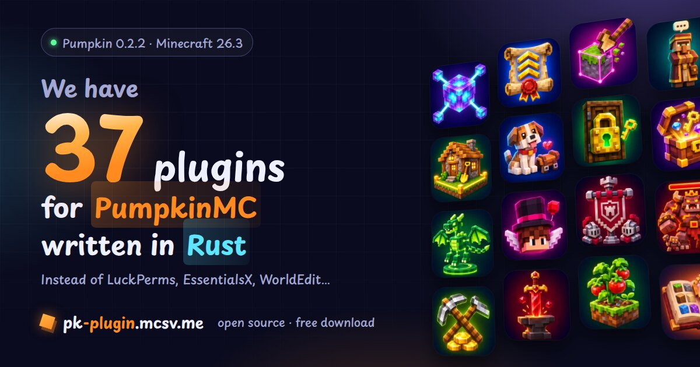

<p align="center">
  <a href="https://pk-plugin.mcsv.me/"></a>
</p>

<h1 align="center">MCSV Pumpkin plugins</h1>

<p align="center">
  为 <a href="https://github.com/Pumpkin-MC/Pumpkin">Pumpkin</a>（用 Rust 编写的 Minecraft Java 服务器）制作的 37 个插件。
</p>

<p align="center">
  <a href="https://github.com/artmasster/pumpkin-plugins/releases/latest"></a>
  &nbsp;
  <a href="https://pk-plugin.mcsv.me/"></a>
</p>

<p align="center">
  
  
  
  
  <a href="https://mcsv.me"></a>
</p>

<p align="center">
  <a href="../README.md">English</a> · <a href="README.th.md">ไทย</a> · <b>简体中文</b> · <a href="README.ja.md">日本語</a>
</p>

---

Paper 和 Spigot 的 `.jar` 插件无法在 Pumpkin 上运行，因此这里的每个插件都承担一个服主早已熟悉的插件的工作，在合理的地方沿用相同的命令。全部插件都是为 Pumpkin 的插件 API 用 Rust 从零编写的，不包含被替代插件的任何代码。

插件由游戏服务器托管商 [MCSV](https://mcsv.me) 制作，运行在 MCSV 的 Pumpkin 服务器上。你自己搭建的 Pumpkin 服务器同样可以使用。

> **状态：** 与 Pumpkin 本身一样尚未到 1.0。基于 Pumpkin `0.2.2+26.3-26.60`（Minecraft 26.3）构建和测试。每个版本都通过单元测试、无界面测试机器人，以及在真实服务器程序上的控制台测试。真实游戏客户端的测试目前还不多，可能会有不完善之处，欢迎反馈。

## 插件

| | 插件 | 替代 | 功能 | 主要命令 |
|---|---|---|---|---|
|  | `basics` | CMI / EssentialsX | 家、传送点、出生点、tpa、随机传送、称号、聊天、邮件、礼包、AFK、经济与出售，以及管理工具（mute、tempban、warn、jail、freeze、vanish） | `/home` `/warp` `/spawn` `/tpa` `/rtp` `/kit` `/rank` `/balance` `/pay` · `/basics` 查看全部 |
|  | `perms` | LuckPerms | 权限组、继承、权重、track、前缀与后缀、临时权限和按世界的权限、通配符，使用 `/lp` 语法 | `/lp user …` `/lp group …` `/lp creategroup` `/lp editor` |
|  | `login` | AuthMe | 在离线模式服务器上用密码注册和登录；可导入 AuthMe 的密码哈希 | `/register` `/login` `/changepassword` · 管理员 `/auth` |
|  | `claims` | GriefPrevention | 用金铲子圈地，三级信任，圈地方块 | `/claim` `/trust` `/untrust` `/claimslist` `/abandonclaim` |
|  | `blocklog` | CoreProtect | 记录方块、容器、聊天和命令；inspector、lookup、rollback、restore、undo | `/co inspect` `/co lookup` `/co rollback u:name t:1h r:20` |
|  | `scripts` | Skript | Skript 风格语法的脚本语言：命令、事件、变量、循环、函数、箱子菜单 | `/sk reload` `/sk list` `/sk enable` `/sk disable` |
|  | `discordlink` | DiscordSRV | 通过 webhook 或机器人令牌，把游戏聊天与 Discord 频道互通 | `/discord` · 管理员 `/discordlink status` |
|  | `tablist` | TAB | 动画页眉页脚，按权限组在 tab 列表和头顶显示前缀与排序，计分板侧栏 | `/tablist reload` |
|  | `worldtools` | WorldEdit | 用木斧选区，set、replace、墙、圆柱、球体、复制、粘贴、schematic、笔刷、撤销 | `//wand` `//set` `//replace` `//copy` `//paste` `//undo` |
|  | `monitor` | spark | TPS 历史、每 tick 耗时、延迟、实体数量、慢 tick 报告 | `/tps` `/spark health` `/spark entities` |
|  | `cleaner` | ClearLag | 定时清理掉落物并提前警告，限制每个区块的生物数量 | `/cleaner now` `/cleaner check` (`/lagg`) |
|  | `motd` | MiniMOTD / Maintenance | 服务器列表中轮换的消息，以及维护模式 | `/maintenance on [30m]` `/maintenance off` |
|  | `worldmap` | BlueMap / squaremap | 随玩家探索绘制的俯视 2D 地图，可由插件自己提供实时网页地图，也可导出为单个 HTML 文件 | `/worldmap render` `/worldmap web <port>` `/worldmap export` |
|  | `resourcepack` | Resource Pack Downloader / ForcePack | 进服时发送资源包，支持多个包、按世界区分、可强制，自行计算 SHA-1 | `/rp` `/rp list` `/rp send` |
|  | `skins` | SkinsRestorer | 在离线模式服务器上使用 Mojang 账号名或图片链接设置皮肤 | `/skin <account>` `/skin url <link>` `/skin clear` |
|  | `placeholders` | PlaceholderAPI | 为其他插件提供 `%player_name%` 形式的占位符，包括它们提供的数值 | `/papi parse` `/papi list` |
|  | `imagemap` | ImageOnMap | 把图片链接变成地图，或由多张地图组成的海报 | `/tomap <link> [2x2]` `/imagemap list` |
|  | `customitems` | Oraxen / ItemsAdder / Nexo | 用几行配置和一张图片做出外观独特的物品：自行生成并发送资源包，自带合成界面，以及可输入任意文本的字形 | `/craft` · 管理员 `/customitems` `/customitems give` `/customitems reload` |
|  | `models` | ModelEngine | 用 Blockbench（`.bbmodel`）制作的动画模型：放在世界中、装到生物上或由玩家穿戴，插件自行生成并发送资源包，并为其他插件提供消息接口 | `/models place` `/models attach` `/models play` `/models list` |
|  | `mobs` | MythicMobs | 用几行配置做出自定义生物：生命、伤害、速度、体型、行为、装备、定时或受伤时触发的技能、掉落物、Boss 血条和刷怪点；安装 Models 后可以穿上模型 | `/mobs spawn` `/mobs spawner add` `/mobs list` `/mobs near` |
|  | `regions` | WorldGuard | 管理员区域（方块范围，加上每个世界的 `__global__`）及标志：建造、交互、PvP、生物伤害与生成、爆炸、火势蔓延、进入、丢弃物品、摔落伤害、无敌、饥饿、进入与离开提示；支持优先级、成员和所有者 | `/rg pos1` `/rg pos2` `/rg define` `/rg flag` `/rg addmember` `/rg list` |
|  | `chatguard` | ChatControl | 识破用空格、句点、重复字母、数字代替字母和泰语声调符号伪装的泰语与英语脏话，并打码或拦截；拦截 IP 和域名广告（`allowed-domains` 除外）、刷屏、重复、喊叫和告示牌，累计次数后处罚 | `/chatguard test <文本>` `/chatguard reload` |
|  | `npcs` | Citizens | NPC 可以是游戏中的生物（无 AI、不会受伤、无声）或穿上 Models 的模型；会转向玩家、沿路线行走，右键时发送消息、执行命令、打开对话、提供任务或传送。对话是带按钮的聊天消息 | `/npc create` `/npc select` `/npc action` `/npc dialog` `/npc path` `/npc list` |
|  | `furniture` | ItemsAdder / Nexo 家具 | 用物品（CustomItems 或游戏原版）放置的家具，按玩家朝向分 4、8 或 16 个方向；可坐、可有碰撞体积，打一下即可收回；遵守 Claims 的领地 | `/furniture give` `/furniture list` `/furniture info` `/furniture reload` |
|  | `cosmetics` | HMCCosmetics | 衣柜：帽子、背饰和跟随的漂浮物（可选是否带拴绳），由 Models 的模型或物品模型（例如 CustomItems 的物品）制作；帽子放在真正的头盔栏位，并让位于盔甲。需要 Models | `/cosmetics` (`/wardrobe`) `/cosmetics wear` `/cosmetics remove` |
|  | `crops` | CustomCrops | 自定义作物：在耕地上种下种子，随时间分阶段生长（可设为只在湿润时生长），支持骨粉、收获和补种；安装后可使用 CustomItems 的物品和 Models 的模型 | `/crops list` `/crops info` `/crops near` `/crops reload` |
|  | `jobs` | Jobs Reborn | 通过挖掘、放置、击杀、钓鱼、合成、冶炼、进食和驯服赚取金钱（经由 Basics）和经验的职业，等级越高收入越多，每隔几秒统一发放 | `/jobs` `/jobs join` `/jobs leave` `/jobs stats` `/jobs top` |
|  | `quests` | Quests / BetonQuest | 带目标（与 Jobs 相同的行为、与 NPC 对话、上交物品）和物品、金钱或命令奖励的任务，支持前置条件、冷却或重复；可在界面或 NPC 处接取 | `/quests` `/quests accept` `/quests abandon` `/quests list` |
|  | `skills` | mcMMO / AuraSkills | 随行为升级的技能：双倍掉落直接进背包、每级额外伤害，以及排行榜和总战力 | `/skills` `/skills stats` `/skills top` |
|  | `clans` | SimpleClans | 带标签和职位（首领、副手、成员）的公会：通过聊天按钮邀请，公会聊天、公会传送点、禁止误伤队友，提供 `%clans_tag%` | `/clan create` `/clan invite` `/clan home` `/cc` `/clan list` |
|  | `market` | AuctionHouse | 玩家上架手中的物品，在确认界面购买；卖家获得扣除 `sales-tax` 后的金额，可设 `listing-fee`，过期物品退回领取箱 | `/market` `/market sell <价格>` `/market mine` `/market box` (`/ah`) |
|  | `crates` | CrazyCrates | 用钥匙开启的箱子方块：界面滚动后按权重停在奖品上，左键查看奖品与概率，带浮动标签和有开箱动画的模型 | `/crates set` `/crates key` `/crates preview` `/crates list` |
|  | `rewards` | DailyRewards / PlaytimeRewards | 连续签到的每日奖励（断一天就重新开始）、在线时长奖励，进服时提醒并附领取按钮，日期按 `utc-offset` 计算 | `/daily` `/daily claim` `/daily playtime` |
|  | `pets` | MyPet | 会跟随（距离太远时传送过来）的宠物，不会受伤，可以骑乘并用玩家按键操控，可以取名，还能穿上 Models 的模型 | `/pets` `/pets call` `/pets dismiss` `/pets name` |
|  | `graves` | GravesX | 死亡时 36 格物品、盔甲和副手物品进入死亡地点的坟墓；主人可原位取回全部物品，其他人在 `public-minutes` 后可以打开，`expire-minutes` 后坟墓消失 | `/graves` `/graves list all` `/graves tp` |
|  | `veinminer` | VeinMiner / TreeCapitator | 潜行并用正确的工具即可一次挖完整条矿脉或砍倒整棵树，最多 `max-blocks` 个；掉落物进背包，工具按方块消耗并在损坏前停止；跳过已被圈占的土地 | `/veinminer`（为自己开启或关闭） |
|  | `pregen` | Chunky | 预生成世界；可暂停、继续，重启后也能接着生成 | `/pregen start` `/pregen pause` `/pregen continue` (`/chunky`) |

LuckPerms、WorldEdit、CoreProtect 等名称属于各自的项目，这里提及它们只是为了说明每个插件承担的工作。这些插件与上述项目没有关联，也未获得其认可。

## 下载

**[从最新版本下载](https://github.com/artmasster/pumpkin-plugins/releases/latest)**：每个插件一个文件，或打包在一个 zip 中，附带 `pumpkin.toml.example` 和 `SHA256SUMS`。版本文件在构建时关闭了 Perms 的网页编辑器（见下文）。[pk-plugin.mcsv.me](https://pk-plugin.mcsv.me/) 上每个插件也有单独的下载按钮。

## 安装

其中 36 个插件是 WASM 组件（`<id>.wasm`），在 Pumpkin 的沙箱中运行。`pregen` 是原生库（`libpregen.so`，Linux x86-64），因为 Pumpkin 的 WASM API 无法加载或生成区块。

1. 把文件放进服务器的 `plugins/` 文件夹。
2. WASM 插件需要在 `pumpkin.toml` 中授予沙箱权限，否则服务器每次启动都会在控制台询问：

   ```toml
   [plugins.overrides.basics]
   allowed_permissions = ["fs.read.data", "fs.write.data"]
   ```

   每个 WASM 插件都需要 `fs.read.data` 和 `fs.write.data`。此外：

   | 插件 | 额外权限 | 原因 |
   |---|---|---|
   | `perms`, `discordlink`, `resourcepack`, `skins`, `imagemap` | `http.outbound`, `network.dns` | 网页编辑器、Discord、资源包哈希、Mojang 皮肤、下载图片 |
   | `worldmap`, `customitems`, `models` | `network.tcp.bind` | 内置网页地图，以及 CustomItems 和 Models 的资源包下载。没有这个权限插件根本不会被加载 |

3. 重启服务器。控制台会为每个插件输出 `Loaded <id> (<version>)`。

每个插件把设置和数据保存在 `plugins/data/<id>/`，首次启动时会在那里写入 `config.toml`。消息默认是泰语；在插件的 `config.toml` 中设置 `language = "en"` 即可使用英语。

原生的 `pregen` 只链接某一个确切的 Pumpkin 版本。请使用为你所运行的 Pumpkin tag 构建的文件，或在 `Cargo.toml` 中修改 tag 后自行构建。WASM 插件在更新的 Pumpkin 版本上仍可加载。

## 须知

- **参数的 Tab 补全已关闭。** 在 Pumpkin 0.2.2 上，当控制台是终端时，WASM 插件的命令补全会让服务器崩溃，所以这些插件都没有注册补全。
- **进出游戏的消息保持原样**，服务器列表显示真实的玩家人数。读取 `X joined the game` 或 ping 结果的工具可以照常工作。
- **Perms 网页编辑器。** `/lp editor` 需要一个编辑器服务。普通构建没有，并会提示这一点；`/lp` 命令可以完成编辑器能做的一切。如需使用你自己的服务，在 `plugins/data/perms/config.toml` 中设置 `editor-url`：插件会发送带有 JSON 会话的 `POST <url>/api/perms-editor` 并期望返回 `{"code": "…"}`，之后 `GET <url>/api/perms-editor/<code>` 返回保存的内容。MCSV 为其托管的服务器运行着这样的服务。
- **CustomItems。** 在 `plugins/data/customitems/items/*.toml` 中描述物品，把图片放进 `textures/`，其他资源包文件放进 `pack/`；`/customitems reload` 会生成 `pack.zip`。插件知道文件位置后玩家才能拿到它：把 `pack.url` 设为你托管文件的链接，或设置 `pack.port` 和 `pack.host` 让插件自己提供下载。配方在插件自己的界面（`/craft`）中制作，原料可以是游戏物品和其他自定义物品：Pumpkin 0.2.2 的工作台只保留配方结果的种类和数量，无法给出自定义物品。物品只在 Java 客户端中显示设计的外观；方块和家具尚未支持。
- **Models。** 把 Blockbench 项目（`.bbmodel`，图片保存在文件内）放进 `plugins/data/models/models/`，然后运行 `/models reload`；首次启动会写入一个示例，可用 `/models place example` 试试。每组方块会成为一个 item display；名为 `idle`、`walk`、`hurt`、`death` 的动画会自动播放，名为 `h_...` 的组会跟随生物视线转动，`tag_...` 是显示名字的位置，名为 `hitbox` 的方块是可点击的部分。以游戏模型文件无法保存的方式旋转的方块会拆成独立部件；网格（mesh）不会被使用。玩家获取资源包的方式与 CustomItems 相同（`pack.url`，或 `pack.port` 和 `pack.host`），作为第二个资源包。用命令放到生物上的模型会一直存在，直到该生物被卸载；其他插件可以用 JSON 消息请求模型（表格位于 `models/src/plugin.rs` 中 `fn ipc` 的上方）。每移动一根骨骼大约花费服务器 6 微秒；可用 `config.toml` 中的 `update-interval`、`far-distance` 和 `max-updates-per-tick` 加以限制。
- **Mobs。** 在 `plugins/data/mobs/mobs/*.toml` 中描述生物（首次启动会写入示例）：它基于哪种游戏生物、各项数值、用于替换行为的 `ai`、`hostile`、`equipment`、`drops`、来自 Models 插件的 `model`，以及包含 `on`（`spawn`、`hurt`、`death`、`timer <秒>`、`health <百分比>`）和要执行的 `do` 列表（`message`、`sound`、`particle`、`damage`、`heal`、`effect`、`summon`、`leap`、`ignite`、`teleport`、`animation`、`command`）的 `skills`。`/mobs spawn <mob>` 生成一只，`/mobs spawner add <名称> <mob>` 会在有玩家靠近时保持该地点有生物。生物在 `despawn-range` 范围内有玩家时存在，不会在重启后保留；刷怪点会保留。Pumpkin 0.2.2 不告知是谁伤害了生物，所以掉落物会直接进入最后一次被击中时离该生物最近的玩家的背包（`customitems:<id>` 给出 CustomItems 的物品），生物本身的掉落物仍会掉在地上。
- **玩法类插件。** Npcs、Furniture、Crates、Pets、Jobs、Quests、Market、Graves、Rewards、Skills、Clans、VeinMiner、Regions、ChatGuard、Cosmetics 和 Crops 首次启动时会在 `plugins/data/<id>/` 写入带注释的配置或示例；金钱使用 Basics。Pumpkin 0.2.2 的限制：插件发送的对话界面到不了客户端，所以 NPC 对话是带按钮的聊天消息；事件给出的是箭而不是射手，所以用弓击杀不计入 Jobs、Quests 和 Skills；VeinMiner 额外挖掉的方块不触发事件，所以 Jobs、Skills 和 BlockLog 看不到，也不计算时运；插件无法把物品掉到地上，所以 VeinMiner、Crops 和各种奖励的物品直接进背包。这 16 个插件已通过测试机器人和控制台测试，但还没有玩家在真实游戏客户端中玩过。
- **插件之间可以互相配合**（一起安装时）：Basics 的聊天会传到 DiscordLink 和 BlockLog，并先经过 ChatGuard 检查；Placeholders 从 Basics 读取余额、从 Perms 读取前缀、从 Clans 读取标签；WorldTools 的编辑会被 BlockLog 记录；Jobs、Quests 和 Skills 统计同一套行为；NPC 可以提供任务；Furniture、Crates、Cosmetics、Crops 和 Pets 使用 CustomItems 的物品和 Models 的模型；Furniture 和 VeinMiner 遵守 Claims 的领地；在 Login 放行之前所有插件都不会处理该玩家。

## 构建

```bash
rustup target add wasm32-wasip2
cargo test --workspace --exclude pregen && cargo test -p pregen --no-default-features
cargo build --release --target wasm32-wasip2 -p basics            # target/wasm32-wasip2/release/basics.wasm
RUST_MIN_STACK=33554432 cargo build --release -p pregen           # target/release/libpregen.so
```

Pumpkin 的版本固定在 workspace 的 `Cargo.toml` 中。要使用更新的 Pumpkin，修改其中每一行 Pumpkin 的 tag 后重新构建。

| 路径 | 内容 |
|---|---|
| `<id>/` | 每个插件一个 crate（`scripts-plugin/` 中是 `scripts`） |
| `common/` | 共享代码：彩色文本、配置和状态文件、不阻塞 tick 的 HTTP、插件之间的消息 |
| `webserver/` | 在服务器 tick 中运行的极小 HTTP 服务器：WorldMap 的网页地图，以及 CustomItems 和 Models 的资源包下载 |
| `packfile/` | 以文件列表和压缩包表示的资源包，内容相同则字节相同：由 CustomItems 和 Models 共用 |
| `scripts/example-model.py` | 生成 Models 的示例模型（`models/src/example.bbmodel`），包含图片 |
| `scripts/particle-table.py` | 从固定 Pumpkin tag 的 WIT 文件生成 `common/src/particles.rs`（粒子名称） |
| `tools/mcbot/` | 用于测试的无界面 Minecraft 26.3 客户端：进入服务器，运行命令和移动脚本，打印服务器发送的内容 |
| `scripts/console-smoke.py` | 像托管面板那样，向作为真实终端的 Pumpkin 控制台输入命令 |
| `scripts/publish.sh` | MCSV 为自家托管运行的发布关卡：测试、发布构建、在真实服务器程序上加载、控制台测试 |
| `scripts/og-image.html`, `scripts/og-image.sh` | 网页分享图片（`site/og.jpg`）和 PNG 图标的源文件与渲染脚本 |
| `site/` | pk-plugin.mcsv.me 网页：纯 HTML、CSS 和 JavaScript，没有构建步骤。`site/img/` 中的插件美术归 MCSV 所有，不在 MIT 许可范围内；字体是 OFL 许可的 Playpen Sans Thai（`site/fonts/OFL.txt`） |
| `docs/` | 本 README 的泰语、简体中文和日语版本及其图片 |

## 由 MCSV 制作

<table>
  <tr>
    <td width="96" align="center"><a href="https://mcsv.me"></a></td>
    <td>
      这些插件由 <a href="https://mcsv.me"><b>MCSV</b></a> 开发和维护。MCSV 是一家位于泰国的 Minecraft 服务器托管商。<br>
      在 MCSV 上，Pumpkin 服务器大约 30 秒即可开好，按天计费，这里的每个插件都能在服务器的插件页面中安装。
    </td>
  </tr>
</table>

## 许可证

[MIT](../LICENSE)。`site/img/` 中的插件美术和 `docs/images/` 中的 MCSV 标志归 MCSV 所有，不在 MIT 许可范围内。
